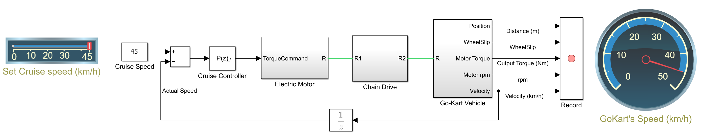
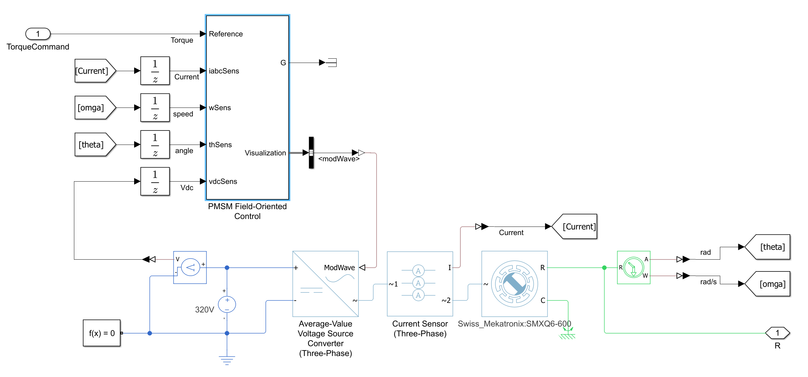
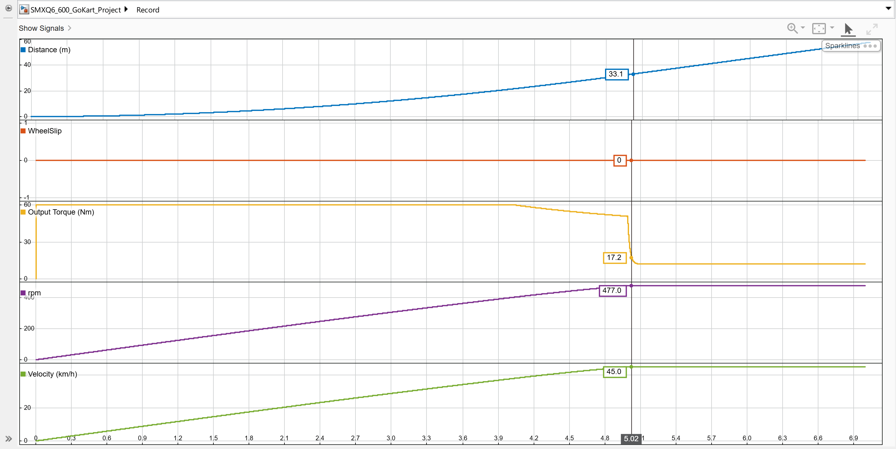

# 🏎️ Electric Go-Kart: PMSM Motor Testing & FOC Tuning

## 📌 Project Overview
This repository contains a system-level MATLAB/Simulink and Simscape model for evaluating and tuning a Permanent Magnet Synchronous Motor (PMSM) drivetrain for a lightweight electric go-kart. Developed as part of the **MathWorks / Coursera Electrified Systems Design Engineer** certification, the project models the electric motor, Field-Oriented Control (FOC) loop, chain drive transmission, and longitudinal vehicle dynamics.

Two candidate motors meeting the initial torque and weight constraints—**Swiss_Mekatronix SMXQ6-600** and **ABB_BALDOR HDS180-4876B**—were parameterized, tuned, and simulated to determine which powertrain achieves the fastest 0 to 45 km/h acceleration. This repository packages the complete, validated simulation environment for the winning motor (**SMXQ6-600**).

---

## ⚙️ Design Requirements & Vehicle Specifications

### Performance Requirements
* **Target Acceleration:** 0 to 45 km/h as quickly as possible
* **Minimum Motor Torque:** ≥ 40 Nm
* **Maximum Motor Mass:** ≤ 30 kg

### Vehicle & Drivetrain Parameters
* **Go-Kart Chassis Mass:** 50 kg
* **Driver Mass:** 30 kg *(plus selected motor mass added to vehicle dynamics)*
* **Transmission:** Chain drive with **2:3 gear ratio** (including sprocket inertia)
* **Vehicle Dynamics:** Models static/kinetic tire friction, wheel slip, body inertia, road incline, and aerodynamic drag

---

## 🏆 Motor Selection & Comparative Results

Both candidate motors were configured with torque-controlled FOC loops (sample time `1e-4 s`) and tested under identical driving conditions.

| Parameter / Metric | Swiss_Mekatronix SMXQ6-600 (Winner) | ABB_BALDOR HDS180-4876B |
| :--- | :---: | :---: |
| **DC Bus Voltage** | 320 V | 560 V |
| **0–45 km/h Acceleration Time** | **5.02 s** | 5.22 s |
| **Distance to 45 km/h** | **33.1 m** | 33.7 m |
| **Wheel Slip** | 0 (No slip) | 0 (No slip) |
| **Result** | **Selected (Faster Acceleration)** | Discarded |

---

## 📐 System Architecture

### 1. Top-Level Vehicle Model

*Caption: Top-level Simulink model featuring interactive Dashboard blocks (cruise speed slider and speedometer), Cruise Controller with torque saturation, Electric Motor, Chain Drive (2:3), Go-Kart Vehicle dynamics, and Record block.*

### 2. Electric Motor & FOC Subsystem (`SMXQ6-600`)

*Caption: Torque-controlled PMSM Field-Oriented Control (FOC) architecture powered by a 320 V DC source and a three-phase Average-Value Voltage Source Converter, with current, rotor speed, and angle feedback.*

---

## 🔍 Control Strategy, Parameterization & FOC Tuning

### Motor & Controller Parameters (`SMXQ6-600`)
* **Electrical & Mechanical Specs:** $V_{dc} = 320\text{ V}$, $P_{max} = 2638\text{ W}$, $T_{max} = 42\text{ Nm}$, $I_{max} = 10.2\text{ A}$, $R_s = 0.3\ \Omega$, $L_d = L_q = 1.8\text{ mH}$, $J = 0.0243\text{ kg}\cdot\text{m}^2$, Pole Pairs ($NPP$) = $20$, Flux Linkage = $0.1033\text{ Wb}$.
* **Computed Inner-Loop FOC PI Gains (Empirical Method):**
  * **D-axis Current PI:** $K_p = 18.0$, $K_i = 3000.0$
  * **Q-axis Current PI:** $K_p = 18.0$, $K_i = 3000.0$
* **Model Workspace Persistence:** Parameters and gains are pushed directly into the `.slx` **Model Workspace** using `Simulink.data.connect`, allowing the main simulation to run standalone without relying on the base MATLAB Workspace.

---

## 📊 Simulation Results (`SMXQ6-600`)

*Caption: Logged telemetry at t = 5.02 s confirming the go-kart reaches 44.9 km/h (target 45 km/h) in 33.1 m with zero wheel slip. Output torque holds steady at 60 Nm during initial acceleration before dropping to 18.3 Nm at cruise speed (476.9 rpm).*

---

## 📂 Repository Structure
* `SMXQ6_600_GoKart_Project.prj` — Simulink Project file managing paths and dependencies.
* `SMXQ6_600_GoKart_Project.slx` — Main system-level electric go-kart simulation model *(pre-loaded with all motor parameters and FOC gains in its Model Workspace)*.
* `SMXQ6_600_FOCgains.slx` & `SMXQ6_600_FOCGainsScript.m` — Auxiliary Motor Control Blockset model and script used to compute empirical FOC PI gains and export `FOCgains.mat`.
* `SMXQ6_600_PMSMBlockParameters.m` — Script that loads `FOCgains.mat` and motor datasheet parameters, writing them directly to the main model's Model Workspace.
* `FOCgains.mat` & `SMXQ6_600_FOCgains.mat` — Precomputed controller gain datasets.

---

## 🚀 How to Run the Project

### Standard Simulation (Ready to Run)
All motor parameters and FOC controller gains are already stored inside the **Model Workspace** of `SMXQ6_600_GoKart_Project.slx`. **You do not need to run any scripts** to execute the simulation:
1. Clone or download this repository.
2. Open MATLAB and double-click `SMXQ6_600_GoKart_Project.prj`.
3. Open `SMXQ6_600_GoKart_Project.slx` and press **Run**.
4. Open the **Record** block to inspect velocity, distance, output torque, RPM, and wheel slip plots.

### Re-tuning for a Different Motor (Optional)
If you swap the PMSM for a different motor, update the datasheet values and re-run the parameterization workflow in this order:
1. Open `SMXQ6_600_FOCgains.slx` and run `SMXQ6_600_FOCGainsScript.m` to push the new motor specs ($R_s, L_d, L_q, J, I_{max}$) to its Model Workspace, simulate (`0 s` stop time), and export the updated `FOCgains.mat`.
2. Open `SMXQ6_600_GoKart_Project.slx` and run `SMXQ6_600_PMSMBlockParameters.m` to load the new gains and motor parameters ($V_{dc}, P_{max}, T_{max}, NPP, \text{flux}$) into the main Model Workspace.
